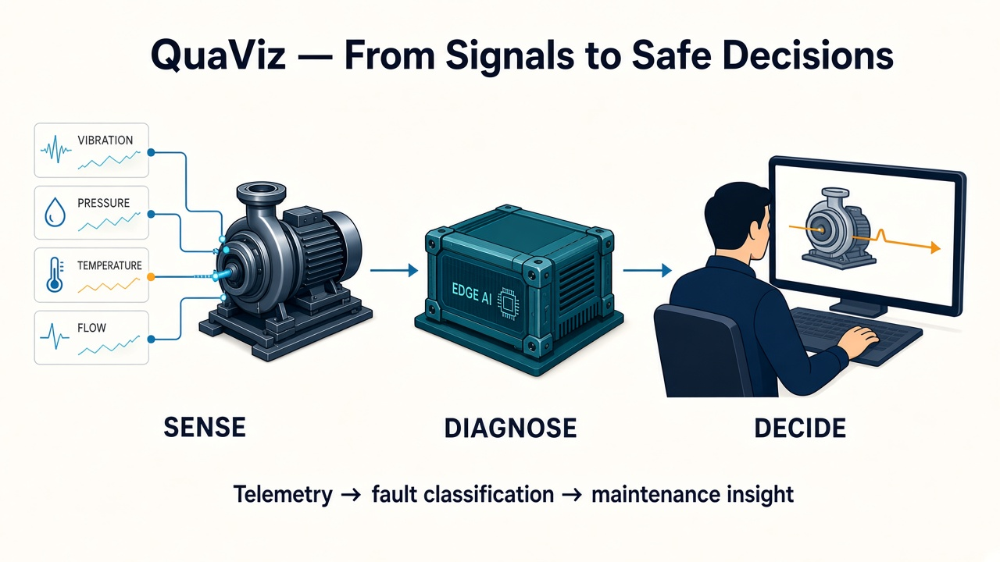
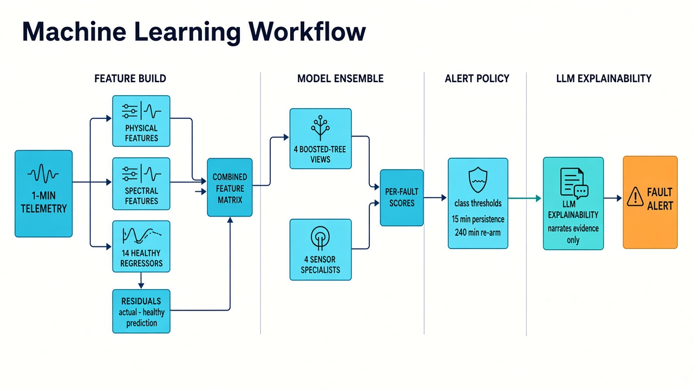
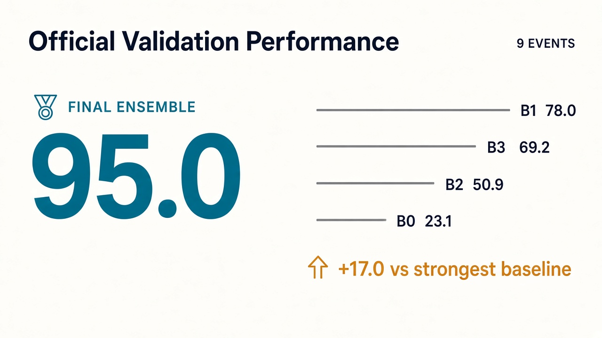
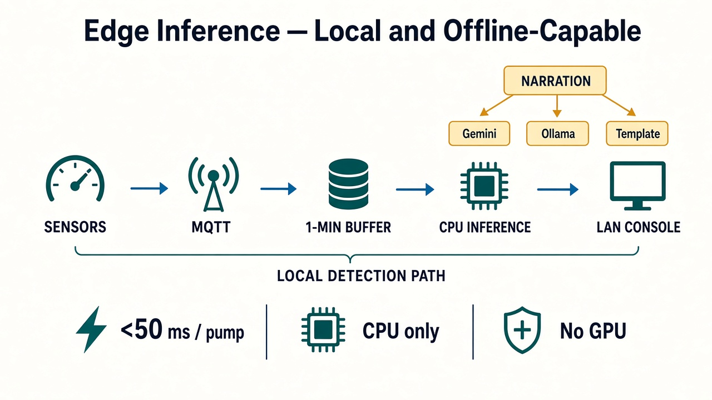
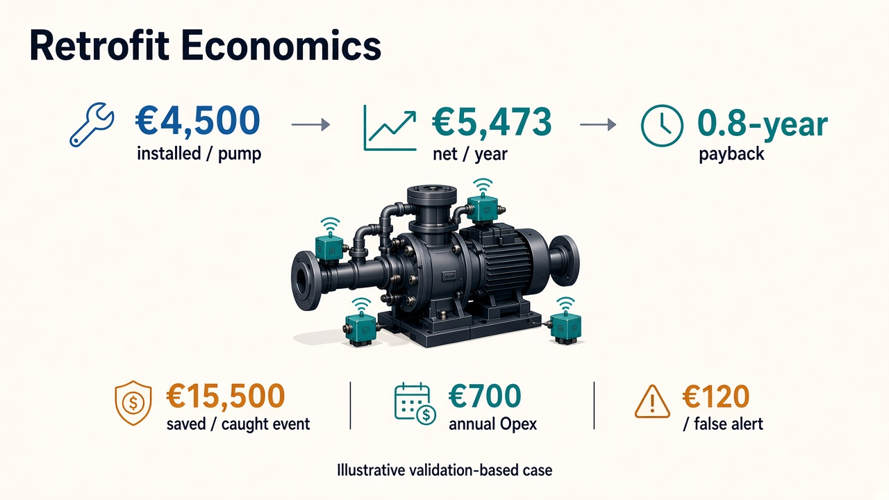
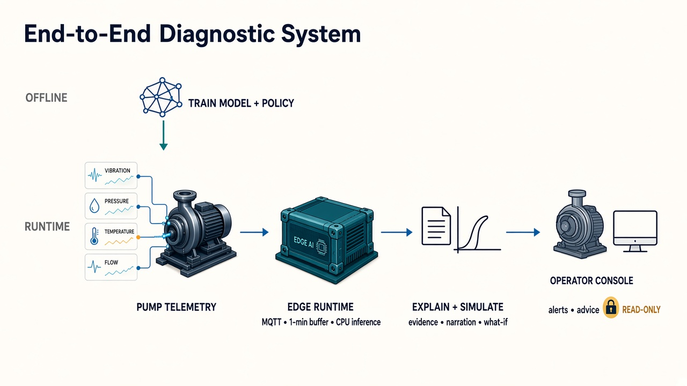
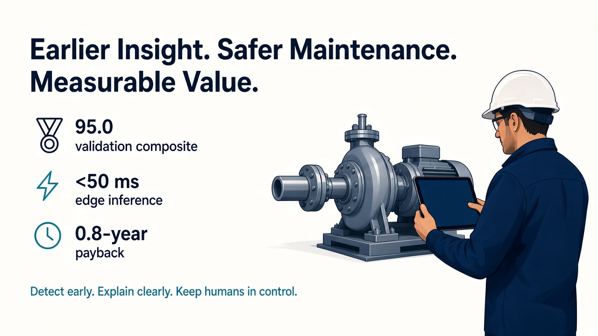

# Retrofit AI / QuaViz — Industrial Pump Fault Diagnosis & Advisory

Team solution for the Since AI 2026 / Business Turku industrial pump-fault challenge. The system provides real-time early fault detection, diagnostic classification (distinguishing mechanical degradation from sensor failures), physical explainability with LLM narration, simulated maintenance what-if impact, and a local plant console designed for edge deployment.



---

## Solution Highlights

1. **Machine Learning Ensemble:**
   - Evaluated and rejected an encode-first deep learning approach (Track 1) due to elevated false-alarm rates and poor fault-type separation.
   - Selected a feature-engineered ensemble (Track 2) that explicitly models healthy pump behavior with 14 regressors, extracts thermodynamic and spectral features, and classifies anomalies using four multi-view boosted trees and four dedicated sensor specialists.

   

2. **Benchmark Performance:**
   - **Official Validation Composite:** **95.0** (vs. Baselines: B1 78.0, B3 69.2, B2 50.9, B0 23.1).
   - **Post-Freeze Holdout (78 events):** **63.5** (vs. Baselines: B2 44.9, B1 41.7, B3 32.3, B0 10.0).

   

3. **Calibrated Operating Point:**
   - Alerts filtered by class-specific sensitivity thresholds, a 15-minute persistence window to eliminate transient process noise, and a 240-minute re-arming delay.
4. **Transparent Explainability & What-If Validation:**
   - *Model decides → features explain → LLM narrates → sandbox measures → human approves.*
   - In 17/17 validation alerts, Google Gemini preserved exact classifier fault types.
   - Sandbox what-if simulations verified that recommended physical repairs (`replace_bearing`, `realign`, `clean_strainer`) reliably reduce risk and restore flow/vibration.
5. **Edge-Ready & Safety-Bounded:**
   - Fast, CPU-only inference (<50 ms per pump) on standard industrial PCs.
   - Fully local telemetry ingestion via MQTT with connectivity-aware narration (Gemini online, Ollama offline, template fallback).
   - Read-only advisory surface: zero control write paths to PLCs, drives, or safety systems.

   

6. **Grounded Retrofit Feasibility & Payback:**
   - Grounded in distributor list-price hardware BOMs (~€2,250 hardware; **~€4,500 total installed capex per pump**).
   - Prevents €24,000 catastrophic failures (10 h downtime + €9k overhaul) through planned €8,500 early interventions (3 h turnaround + localized repair), saving **€15,500 per event**.
   - Alert calibration limits nuisance costs (€120/false alarm check) to yield **€5,473/year in net savings per pump** with a **0.8-year payback**.
   - Read-only integration conforming to IEC 62443, NIST SP 800-82, and maritime IACS UR E26/E27 cybersecurity standards.

   

---

## Repository Structure & Key Deliverables



```
Retrofit-AI-QuaViz/
  submissions/                  # Submission deliverables and paper-style documentation
    README.md                   # Detailed overview of deliverables and definitions
    predictions_test.csv        # Final challenge test predictions CSV (PUMP-10..12)
    system/system.md            # End-to-end data flow and architectural boundaries
    01_training/training.md     # Model exploration, selection, and benchmark figures
    02_calibration/calibration.md # Alert policy thresholds and persistence tuning
    03_whatif/whatif_validation.md # LLM narrative validation and sandbox what-if results
    04_edge/edge_design.md      # On-device CPU inference, MQTT, and LAN console
  retrofit_starter/             # Challenge starter kit, datasets, and training recipes
    solution/final_model/       # Frozen model bundle (model.joblib, policy.json, infer.py)
    submission/predictions_test.csv # Challenge submission CSV (identical copy)
    SOLUTION.md                 # Comprehensive technical research narrative
    RETROFIT_FEASIBILITY.md     # Hardware bill of materials and OT network integration
  app/
    backend/                    # FastAPI real-time service with MQTT ingestion & inference
    frontend/                   # Operator fleet console (Vite + React single-page app)
```

### Quick Navigation

| Deliverable | Location | Description |
|---|---|---|
| **Test Predictions CSV** | [`submissions/predictions_test.csv`](submissions/predictions_test.csv) | Official submission file for test pumps PUMP-10 through PUMP-12 |
| **Submission Documentation** | [`submissions/README.md`](submissions/README.md) | Chapter-by-chapter walkthrough of training, calibration, and edge design |
| **Technical Narrative** | [`retrofit_starter/SOLUTION.md`](retrofit_starter/SOLUTION.md) | Complete research log, baseline comparisons, and trade-off analyses |
| **Frozen Model Bundle** | [`retrofit_starter/solution/final_model/`](retrofit_starter/solution/final_model/) | Trained model (`model.joblib`), policy (`policy.json`), and inference script |
| **Product Backend** | [`app/backend/`](app/backend/) | Real-time diagnostic server (REST, WebSockets, MQTT subscriber) |
| **Operator Console** | [`app/frontend/`](app/frontend/) ([`README`](app/frontend/README.md)) | Live browser dashboard for plant operators |

---

## Environment Setup

Create and activate a virtual environment at the repository root using [uv](https://docs.astral.sh/uv/) (Python 3.12 recommended):

```sh
cd Retrofit-AI-QuaViz

# Create virtual environment
uv venv --python 3.12
source .venv/bin/activate          # Windows: .venv\Scripts\Activate.ps1

# Install dependencies and editable challenge simulator
uv pip install -r requirements.txt
uv pip install -e ./retrofit_starter --no-deps

# Configure environment variables (optional: set GEMINI_API_KEY)
cp .env.example .env
```

Verify that you are using the repository virtual environment:

```sh
which python
# Should output: /path/to/Retrofit-AI-QuaViz/.venv/bin/python
```

---

## How to Run

### 1. Generate Test Predictions CSV

To execute offline inference on the official test split (PUMP-10 through PUMP-12) using the frozen model and alert policy:

```sh
source .venv/bin/activate
export QUAVIZ_CHALLENGE_DIR="$(pwd)/retrofit_starter"

cd retrofit_starter/solution/final_model
python infer.py \
  --model model.joblib \
  --policy policy.json \
  --data "$QUAVIZ_CHALLENGE_DIR/data/full" \
  --split test \
  --output "$QUAVIZ_CHALLENGE_DIR/../submissions/predictions_test.csv"

# Keep the submission folder synchronized
cp "$QUAVIZ_CHALLENGE_DIR/../submissions/predictions_test.csv" \
   "$QUAVIZ_CHALLENGE_DIR/submission/predictions_test.csv"
```

The output file [`submissions/predictions_test.csv`](submissions/predictions_test.csv) contains the final alert rows evaluated by the challenge scorer.

---

### 2. Run What-If and Explainability Batch Validation

To regenerate the LLM operator explanations and sandbox what-if impact cards for the validation set (requires `GEMINI_API_KEY` in `.env`):

```sh
source .venv/bin/activate
set -a && source .env && set +a
export QUAVIZ_CHALLENGE_DIR="$(pwd)/retrofit_starter"

cd retrofit_starter/solution/final_model
python -m explainability.batch_validation \
  --provider gemini \
  --output-dir "$QUAVIZ_CHALLENGE_DIR/../submissions/03_whatif/results"

# Regenerate summary figures
python ../../../submissions/03_whatif/make_figures.py
```

Results are saved to [`submissions/03_whatif/results/whatif_validation.csv`](submissions/03_whatif/results/whatif_validation.csv) and per-alert JSON cards.

---

### 3. Launch the Live Edge Demo (One-Click)

The repository includes an end-to-end orchestration script that starts a local MQTT broker (Mosquitto), telemetry publishers, the diagnostic backend, and opens the operator fleet console:

```sh
./start.sh
```

- **Operator Dashboard:** [http://127.0.0.1:5173](http://127.0.0.1:5173)
- **Backend API & Swagger Docs:** [http://127.0.0.1:8000/docs](http://127.0.0.1:8000/docs)

**Useful runtime options:**
```sh
# Smoke test: single asset, 3-hour window, as-fast-as-possible replay
START=2025-09-10T08:00:00Z END=2025-09-10T11:00:00Z ASSET=PUMP-08 SPEED=0 ./start.sh

# Run with local template narration without calling external LLM APIs
LLM_PROVIDER=template ./start.sh
```

Press `Ctrl+C` in your terminal to cleanly stop all background processes.

---

### 4. Manual Multi-Terminal Execution (API Only)

If you prefer running services individually without the frontend UI:

**Terminal 1 (Backend Service):**
```sh
source .venv/bin/activate
cd app/backend
python -m quaviz_backend serve --mqtt-host 127.0.0.1 --provider template
```

**Terminal 2 (Telemetry Replay Gateway):**
```sh
source .venv/bin/activate
cd retrofit_starter
python -m retrofit_sim replay --data data/full --asset PUMP-08 --mqtt-host 127.0.0.1 --speed 0
```

*(If no MQTT broker is installed, telemetry can also be piped directly via stdin; see [`app/backend/README.md`](app/backend/README.md)).*

---



---

## Safety Boundary Notice

The system operates strictly as an **advisory and diagnostic tool**. All recommendations are intended for review by qualified plant maintenance personnel. The system has **no direct write access or control path** to plant PLCs, variable-frequency drives, emergency shutdown valves, or safety instrumented systems (SIS).
