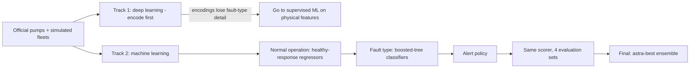
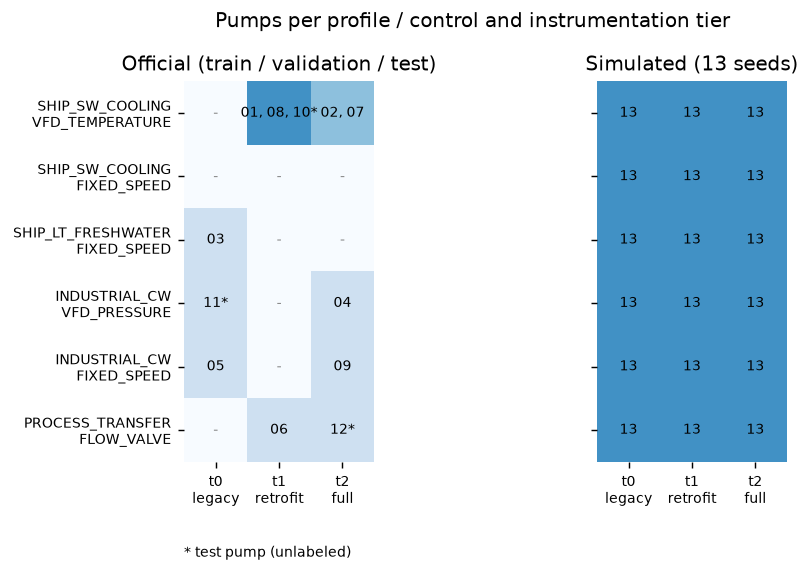
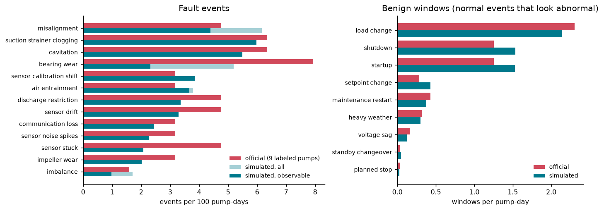
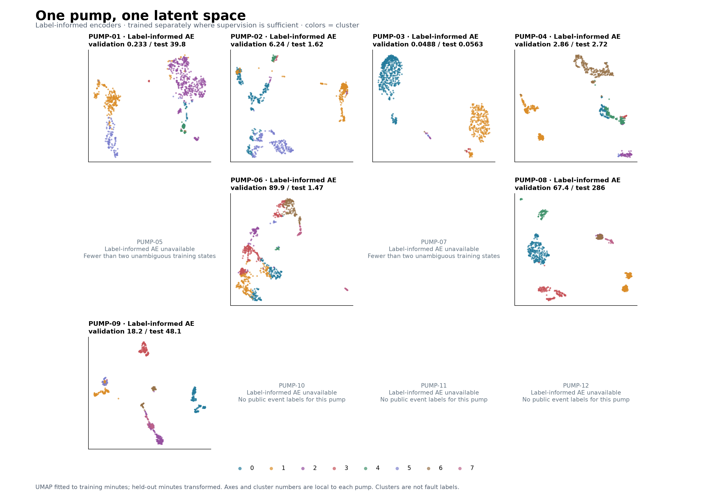
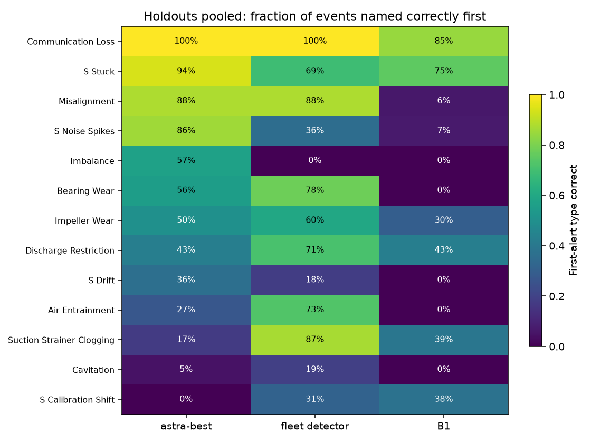

# Solution: pump fault detection and diagnosis

This document is the documentation of what we tried, what we kept, and why. The frozen submission model is in [`solution/final_model/`](solution/final_model/). The test-pump alerts are in [`submission/predictions_test.csv`](submission/predictions_test.csv).



## 1. Problem and scoring

The challenge asks for alerts that name the right fault type on centrifugal pumps.


## 2. Data

| Source | Role |
|---|---|
| Official train PUMP-01…07 | Primary labeled training |
| Official validation PUMP-08/09 | Headline number (used for selection by the final model; not by the fleet detector) |
| Official test PUMP-10…12 | Submission only; never labeled or tuned on |
| Our simulated fleets (`build/sim`, 13 seeds, 234 pumps) | Volume and coverage for the fleet detector; s0112/s0113 held out |
| Final-model synthetic roles | Training / development / frozen holdout for the ensemble |

Fidelity of our simulated fleets against the official pumps was checked before training (coverage and event mix):





## 3. Track 1 — deep learning: encode first

Before training a deep detector we asked whether compressing each minute into a short vector keeps the information needed for diagnosis. Six encoders produce **32 numbers per minute** (PCA, kernel PCA, plain / denoising / temporal autoencoders, and a label-informed autoencoder). Details: [`solution/encoding/`](solution/encoding/).

**Findings**

1. PCA keeps the most input information on 11 of 12 pumps.
2. For “fault present”, the label-informed autoencoder leads the original within-pump study (validation AP **0.770**). With 108 extra simulated recordings, a fault-trained task encoder reaches **0.869** fresh-test AP against **0.827** for kernel PCA.
3. Classifiers on the **full feature set** name individual fault types better than classifiers on the encodings.




**Decision:** do not build the submission as a deep model on the encodings. A small neural detector was also trained later and rejected (79.8 on validation under its own policy search); code remains in `solution/final_model/neural.py`.

## 4. Track 2 — machine learning

Both ML approaches share one idea: learn what healthy operation looks like, then classify the deviations.

### Normal operation

Healthy-response regressors are fitted only on healthy steady minutes. Their gaps to the actual readings become evidence. Controllers’ own outputs (speed, valve) are treated carefully so compensating for a fault still shows up as a deviation.

- **Final model:** 14 channel regressors, plus physics features (pump-curve and suction departures, nameplate ratios, vibration harmonics and bearing envelopes from snapshots).
- **Fleet detector:** two fleet-wide models (operating-point and channel-consistency) with nameplate-scaled inputs and out-of-fold scoring so every training pump is evaluated by a model that never saw it.


### Fault type

- **Final model (astra-best):** four equally weighted boosted-tree views for machine faults and gateway loss, plus **four shared per-channel sensor specialists** (drift, stuck, calibration shift, noise).
- **Fleet detector:** one multiclass histogram-gradient-boosted classifier over NORMAL + 13 fault types on 367 causal window features (raw-signal windows + stage-1 deviation features).

### Alert policy

Persistence before alerting, inhibition while stopped (except communication loss), re-arming after the score falls, and limited reminders. Thresholds are selected on development data with the official scorer.

## 5. Evaluation

Every method below is scored with the **same official scorer**. Numbers for the final model on validation and on its holdout were reproduced exactly from the frozen `model.joblib`. The full table is in [`solution/comparison/results/comparison.csv`](solution/comparison/results/comparison.csv).

| Set | **Final (astra-best)** | Fleet detector | B1 | B3 | B2 | B0 |
|---|---:|---:|---:|---:|---:|---:|
| Validation (9 events) | **95.0** | 75.0 | 78.0 | 69.2 | 50.9 | 23.1 |
| Our holdout s0112 (78) | 54.5 | **67.4** | 55.7 | 38.0 | 47.9 | 38.4 |
| Our holdout s0113 (68) | 50.7 | **61.2** | 47.0 | 32.4 | 41.8 | 38.3 |
| Astra holdout (78) | **63.5** | 52.5 | 41.7 | 32.3 | 44.9 | 10.0 |





### Final model: astra-best ensemble

We select the **astra-best** ensemble as the submission. It is best on validation (95.0) and on the holdout closest to the official pumps (63.5), and it beats every baseline on all four sets.

**Why we also think it is more general and robust**

1. **Per-channel sensor specialists**, shared across channels, so they carry over when the instrument layout changes.
2. **Physics-derived features**: pump-curve and suction departures, nameplate ratios, vibration harmonics and bearing envelopes.
3. **Training on crossed control and instrumentation combinations**, with an ensemble of four views rather than a single classifier.
4. **It still beats every baseline** on a holdout frozen before it was generated, and on our independently generated fleets.

The fleet detector remains as a second approach: stronger on hydraulic faults (clogging, discharge restriction, air entrainment) on our holdouts, weaker on sensor faults and on the astra holdout’s ±15% rating spread. The two are complementary; the ensemble’s sensor branch is the piece that decides the selection.

## 6. Honest limits

- Validation was used to select the final model and its policy. The 95.0 is not a blind estimate. Prefer the frozen holdout (63.5) and the cross-generator numbers above.
- Cavitation and calibration shifts stay weak for both ML approaches.
- The final model raises more false alerts on our broader fleets than the fleet detector does.
- All results come from one simulator family, not field data.

## 7. How to run

```sh
cd RETROFIT_AI_PARTICIPANTS_2026
source .venv/bin/activate
export QUAVIZ_CHALLENGE_DIR="$PWD"

# Final model on validation (should score ~95.02)
cd solution/final_model
python infer.py --model model.joblib --policy policy.json \
  --data "$QUAVIZ_CHALLENGE_DIR/data/full" --split validation \
  --output /tmp/val.csv
PYTHONPATH="$QUAVIZ_CHALLENGE_DIR/src" python -m retrofit_sim score \
  --predictions /tmp/val.csv \
  --events "$QUAVIZ_CHALLENGE_DIR/data/full/events_validation.csv" \
  --assets "$QUAVIZ_CHALLENGE_DIR/data/full/assets.csv" \
  --benign "$QUAVIZ_CHALLENGE_DIR/data/full/benign_windows_train_validation.csv" \
  --split validation

# Test submission (already written to submission/predictions_test.csv)
python infer.py --model model.joblib --policy policy.json \
  --data "$QUAVIZ_CHALLENGE_DIR/data/full" --split test \
  --output "$QUAVIZ_CHALLENGE_DIR/submission/predictions_test.csv"
```

Retrain the final model: see [`solution/final_model/TRAINING.md`](solution/final_model/TRAINING.md).  
Fleet detector: see [`solution/fleet_detector/README.md`](solution/fleet_detector/README.md).  
Encoding study: see [`solution/encoding/README.md`](solution/encoding/README.md).  
Rebuild figures: `python solution/make_figures.py`.

## 8. Folder map

```
RETROFIT_AI_PARTICIPANTS_2026/
  SOLUTION.md                 ← this story
  submission/predictions_test.csv
  solution/
    final_model/              ← frozen ensemble + inference (THE model)
    fleet_detector/           ← second ML approach + cache + results
    encoding/                 ← deep-learning encode-first study
    comparison/               ← head-to-head on four sets
    figures/                  ← plots linked above
    make_figures.py
```
