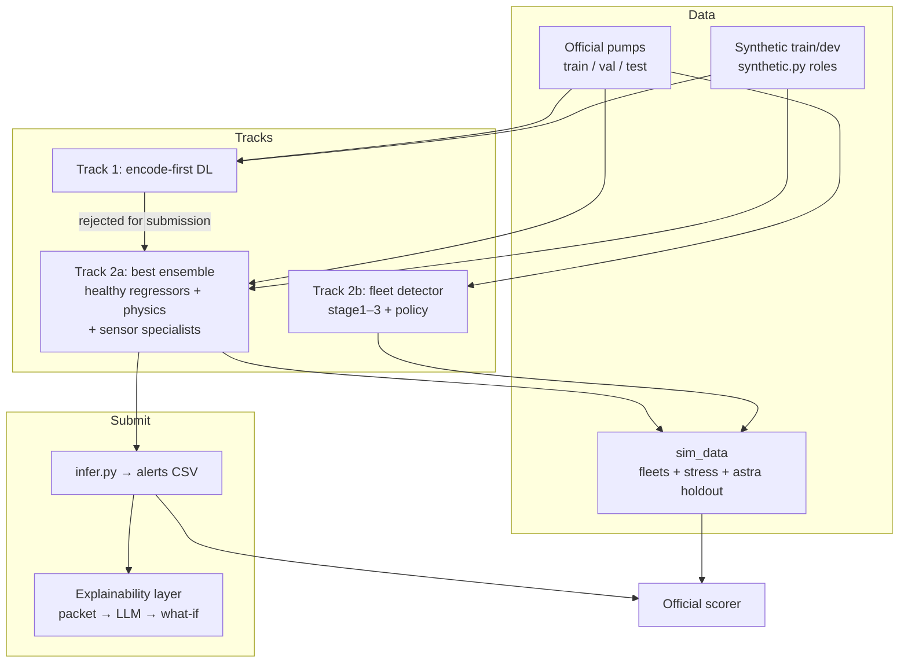
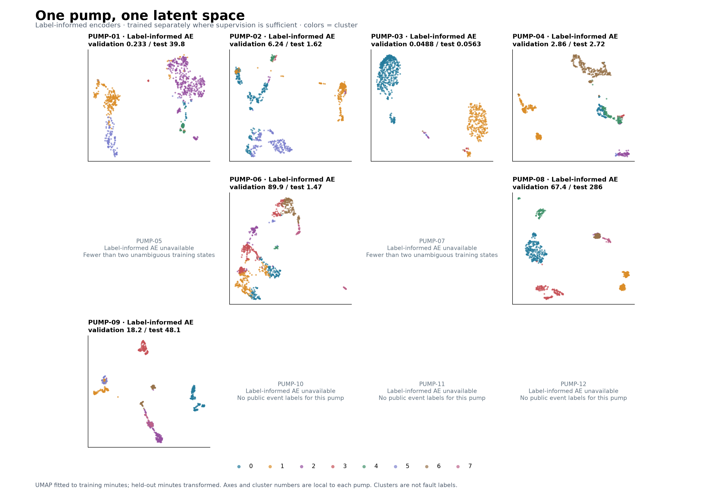
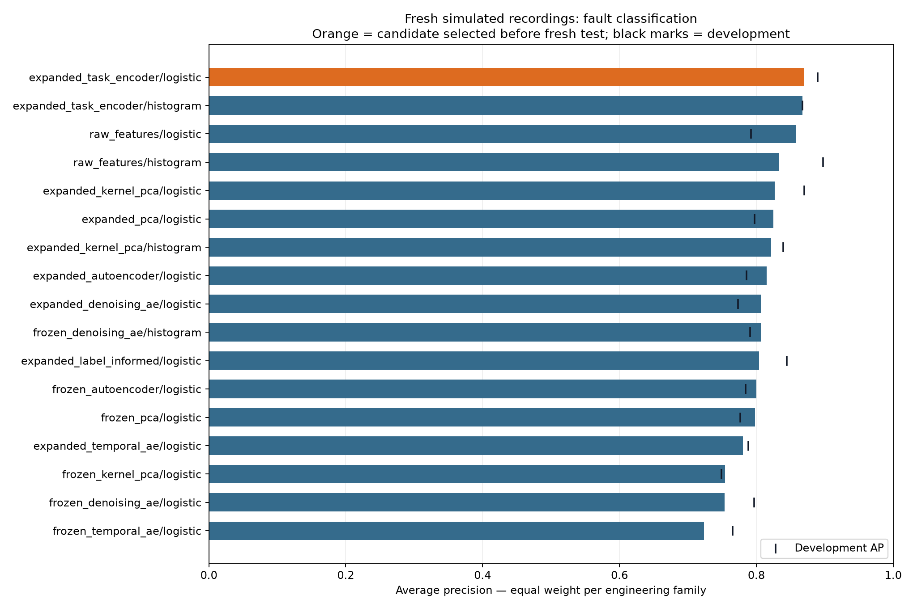
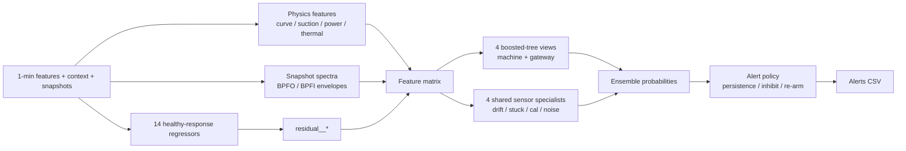
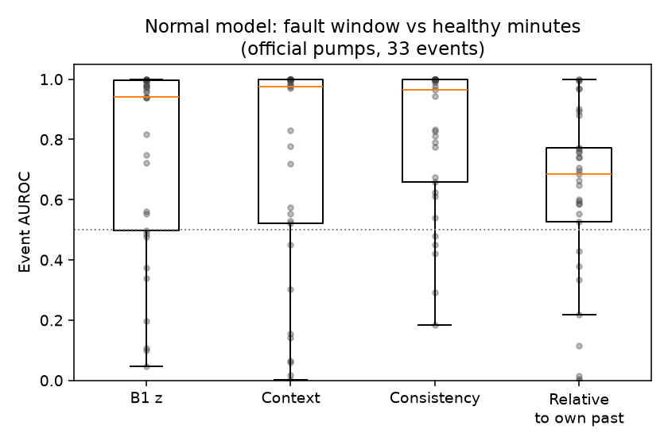
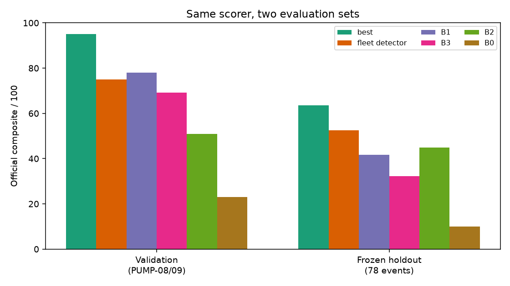
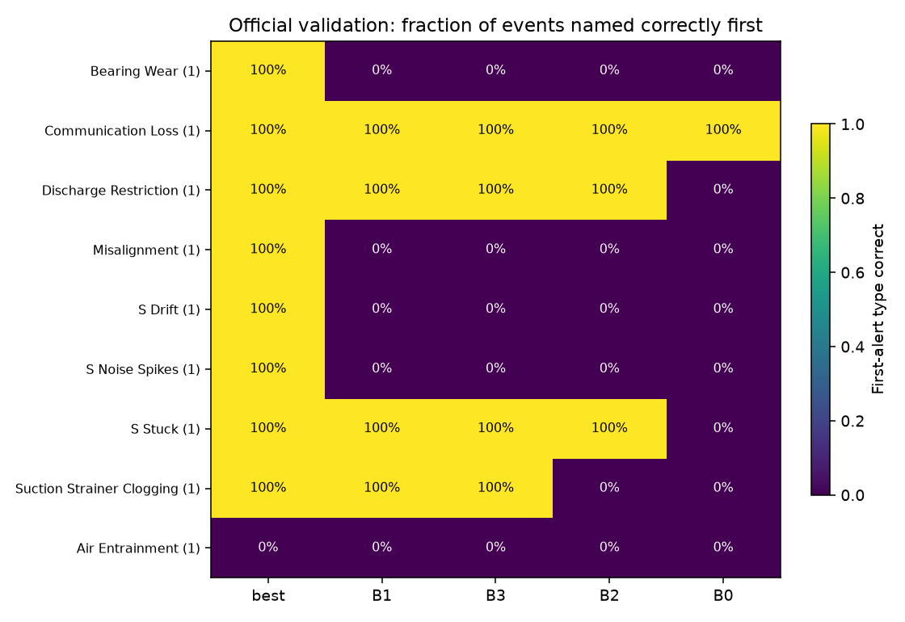
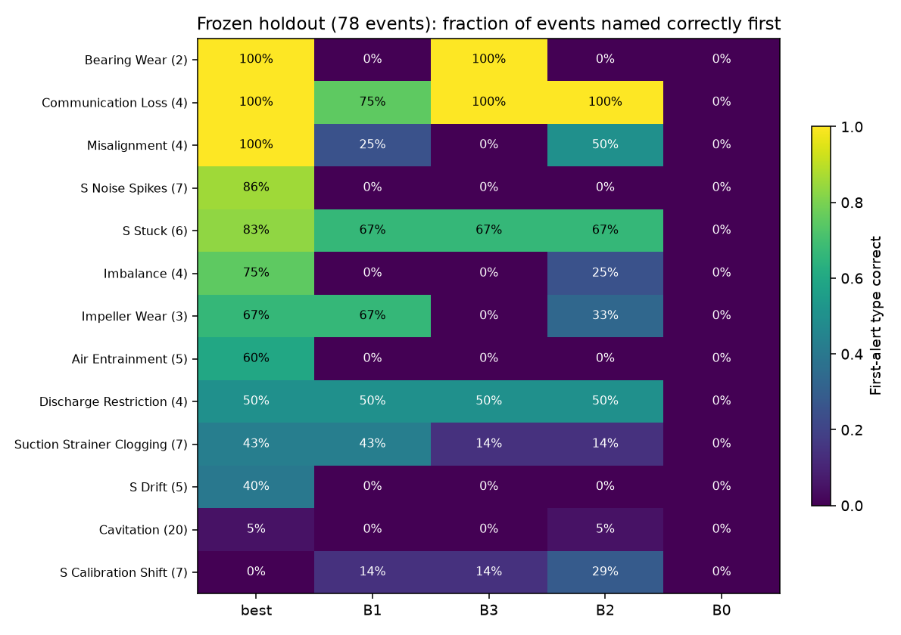
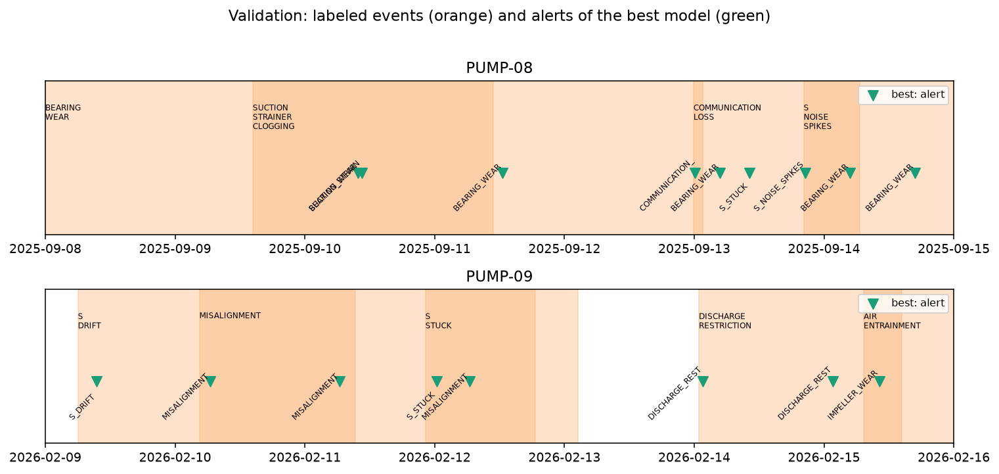
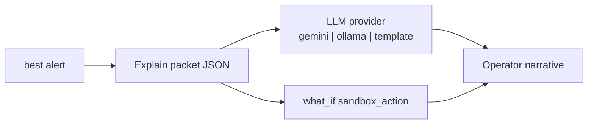

# Solution: pump fault detection, diagnosis, and operator explainability

What we tried, what we kept, how it is scored, and how an operator sees evidence.  
**Submission model:** frozen ensemble **best** in [`solution/final_model/`](solution/final_model/).  
**Test alerts:** [`submission/predictions_test.csv`](submission/predictions_test.csv).

---

## 0. System at a glance



**Design split**

| Layer | Responsibility |
|---|---|
| **best** (frozen) | Decide fault type + confidence; never retrained for explainability |
| **Explain packet** | Top residuals / physics / snapshots vs healthy expectation |
| **LLM** (Gemini / Ollama / template) | Narrate for operators; cannot change `fault_type` |
| **Sandbox what-if** | Measure recommended action in simulation only |

Principles: *model decides → features explain → LLM narrates → sandbox measures → human approves.*  
Details: [`solution/final_model/EXPLAINABILITY.md`](solution/final_model/EXPLAINABILITY.md).

---

## 1. Problem and scoring

Centrifugal cooling-water pumps: raise early alerts, name the fault (including sensor vs machine), show evidence, recommend an inspection — **never** control the plant.

Measured with the **unchanged official scorer** (composite 0–100): event detection, timeliness, type/class recall, false-alert rate.

---

## 2. Data

| Source | Role |
|---|---|
| Official train PUMP-01…07 | Primary labeled training |
| Official validation PUMP-08/09 | Development / selection for **best** (9 events) |
| Official test PUMP-10…12 | Submission only; never labeled or tuned on |
| `synthetic.py` roles | Extra train/dev; **astra holdout** (21 pumps, 78 events) generated only after freeze |
| `sim_data/` (local, not in git) | Generalizability set: fleets s0200–s0212, stress seed 42, astra holdout |

`sim_data` layout: `fleets/` (simfleet), `stress/` (`make_dataset --tier stress`), `astra/holdout/` (frozen-protocol synthetic). Regenerable; see `sim_data/README.md` when present.

---

## 3. Track 1 — deep learning: encode first

Question: can a 32-D minute encoding keep enough information for diagnosis?

Six encoders (PCA, kernel PCA, plain / denoising / temporal AEs, label-informed AE). Details: [`solution/encoding/`](solution/encoding/).

**Findings**

1. PCA keeps the most input information on 11 of 12 pumps.
2. Fault-present detection: label-informed AE led an early within-pump study (val AP **0.770**); with more sims a task encoder reached fresh-test AP **0.869** vs kernel PCA **0.827**.
3. Minute-level recall at development cutoffs still left high FPR for several encodings; **naming fault types** was weaker on encodings than on the full feature set.
4. A small neural detector was later tried and rejected (**79.8** validation under its own policy search).





**Decision:** do not submit a deep encode-first detector.

---

## 4. Track 2 — machine learning

Shared idea: learn healthy behaviour, then classify deviations.

### Architecture of **best** (submission)



- **Normal operation:** regressors on healthy steady minutes; controller outputs treated carefully so compensation still shows as deviation.
- **Fault type:** four equally weighted views + four per-channel sensor specialists.
- **Policy:** persistence, stop/startup inhibition (except gateway loss), recovery re-arm, limited reminders. Tuned with equal weight on official validation + synthetic development — so **validation 95.0 is not blind**.

### Fleet detector (second approach)

Fleet-wide normal models (operating-point + consistency), 367 causal window features, multiclass HGB over NORMAL + 13 faults, own alert policy.  
Code: [`solution/fleet_detector/`](solution/fleet_detector/).



---

## 5. Evaluation

Same official scorer everywhere. Frozen `model.joblib` numbers reproduced for validation and astra holdout.

### 5.1 Headline sets (historical comparison)

From [`solution/comparison/results/comparison.csv`](solution/comparison/results/comparison.csv):

| Set | **best** | B1 | B3 | B2 | B0 |
|---|---:|---:|---:|---:|---:|
| Validation (9 events) | **95.0** | 78.0 | 69.2 | 50.9 | 23.1 |
| Astra frozen holdout (78) | **63.5** | 41.7 | 32.3 | 44.9 | 10.0 |









### 5.2 Unified `sim_data` generalizability (new)

Generated after the submission freeze; models **not** retrained. Scored with [`solution/comparison/compare_sim_data.py`](solution/comparison/compare_sim_data.py). Results: `solution/comparison/results/sim_data/` (local).

| Set | Events | **best** | quaviz | B1 | B2 | B3 | B0 |
|---|---:|---:|---:|---:|---:|---:|---:|
| Fleets s0200–s0212 | 774 | 56.3 | **67.9** | 53.1 | 48.6 | 37.8 | 25.3 |
| Stress (seed 42) | 34 | **70.0** | 68.7 | 64.4 | 54.0 | 54.6 | 28.7 |
| Astra holdout | 78 | **63.5** | 52.5 | 41.7 | 44.7 | 32.3 | 10.0 |
| **Pooled all** | **886** | 57.4 | **66.6** | 52.6 | 48.6 | 38.1 | 24.4 |

**How to read this**

- **best** remains strongest on official validation and on its **own-protocol** astra holdout (and leads stress).
- **quaviz** leads on new **simfleet-style** fleets and thus on the pooled set (fleet events dominate).
- Winning on “astra holdout” is **not** a neutral astra-vs-quaviz verdict: that set is generated by `synthetic.py` (same family as best’s train/dev). Conversely, fleets match quaviz’s simfleet world more closely.
- Fleet eval for **best** had **no vibration snapshots** (simfleet default), which can understate physics/snapshot features.

### 5.3 Why we still submit **best**

1. Organizer-scored test pumps (PUMP-10…12) are the **official challenge family**, where best is strongest on validation and remains ahead of baselines on the post-freeze astra holdout.
2. Sensor specialists + physics + crossed instrumentation training are built for instrument-layout transfer and sensor-vs-machine naming.
3. Frozen artifacts + `predictions_test.csv` already locked; quaviz is documented as the complementary transfer model on broad fleets.

On the astra holdout, quaviz more often names clogging/cavitation; best is clearly stronger on sensor noise and imbalance — complementary, not redundant.

---

## 6. Operator explainability (on top of best)

Additive layer; submission CSV format unchanged.



**Packet** (built in `explainability/packet.py`): fault, confidence, top `residual__*` / `phys__*` / `snapshot__*`, context, static recommendation text, `sandbox_action`.

**LLM contract:** system prompt + packet only; structured `{summary, likely_cause, what_to_check, do_not_do, uncertainty_note}`; `fault_type` forced from the packet.

**Sandbox map (examples):** clogging → `clean_strainer`; bearing → `replace_bearing`; misalignment → `realign`; sensors → `inspect`.

```sh
cd solution/final_model
pip install -r explainability/requirements.txt
python -m explainability --asset PUMP-08 --provider gemini
```

Provider switch via `LLM_PROVIDER` in repo-root `.env` (see `.env.example`). Never commit `.env`.

---

## 7. Honest limits

- Validation entered **best** model/policy selection → **95.0 is optimistic**; prefer astra holdout (63.5) and `sim_data` for transfer claims.
- Cavitation and calibration shift remain weak spots.
- Confidence is **not** calibrated.
- All results are from one simulator family, not field data.
- Explainability LLM does not improve detection score; it improves operator communication. Advice only — no plant commands.
- Edge BOM / pilot narrative: [`RETROFIT_FEASIBILITY.md`](RETROFIT_FEASIBILITY.md).
- Live path: [`solution/final_model/deploy/`](solution/final_model/deploy/) buffers `retrofit_sim replay` / JSONL → official `features_1min` → frozen **best** (optional explain). Context/snapshots still come from the asset store, not invented from the 1 s stream.

---

## 8. How to run

```sh
# from repo root: uv venv --python 3.12 && source .venv/bin/activate
#                  uv pip install -r requirements.txt
#                  uv pip install -e ./retrofit_starter --no-deps
cd retrofit_starter
export QUAVIZ_CHALLENGE_DIR="$PWD"


# best on validation (~95.02)
cd solution/final_model
python infer.py --model model.joblib --policy policy.json \
  --data "$QUAVIZ_CHALLENGE_DIR/data/full" --split validation \
  --output /tmp/val.csv
PYTHONPATH="$QUAVIZ_CHALLENGE_DIR/src" python -m retrofit_sim score \
  --predictions /tmp/val.csv \
  --events "$QUAVIZ_CHALLENGE_DIR/data/full/events_validation.csv" \
  --assets "$QUAVIZ_CHALLENGE_DIR/data/full/assets.csv" \
  --benign "$QUAVIZ_CHALLENGE_DIR/data/full/benign_windows_train_validation.csv" \
  --split validation

# Test submission
python infer.py --model model.joblib --policy policy.json \
  --data "$QUAVIZ_CHALLENGE_DIR/data/full" --split test \
  --output "$QUAVIZ_CHALLENGE_DIR/submission/predictions_test.csv"

# Operator card (LLM + what-if)
python -m explainability --asset PUMP-08 --provider gemini

# Live/near-live: replay → 1-min aggregate → best
python -m deploy --asset PUMP-08 --start 2025-09-10T08:00:00Z --end 2025-09-10T11:00:00Z --infer-every 0

# sim_data head-to-head (needs local sim_data/)
cd ../comparison
python compare_sim_data.py --reuse    # if results already present
```

Retrain best: [`solution/final_model/TRAINING.md`](solution/final_model/TRAINING.md).  
Fleet detector: [`solution/fleet_detector/README.md`](solution/fleet_detector/README.md).  
Encoding: [`solution/encoding/README.md`](solution/encoding/README.md).  
Figures: `python solution/make_figures.py`.

---

## 9. Folder map

```
Retrofit-AI-QuaViz/
  retrofit_starter/                ← challenge kit (this package)
    SOLUTION.md                    ← this document
    submission/predictions_test.csv
    sim_data/                      ← local only (gitignored); fleets + stress + astra
    solution/
      final_model/                 ← frozen best + infer + explainability/ + deploy/
      fleet_detector/              ← quaviz second track
      encoding/                    ← encode-first study (rejected for submit)
      comparison/                  ← official + sim_data scorers
      figures/
  app/
    backend/                       ← quaviz_backend: MQTT → aggregate → best → explain → API
    frontend/                      ← operator UI (empty for now)
```
