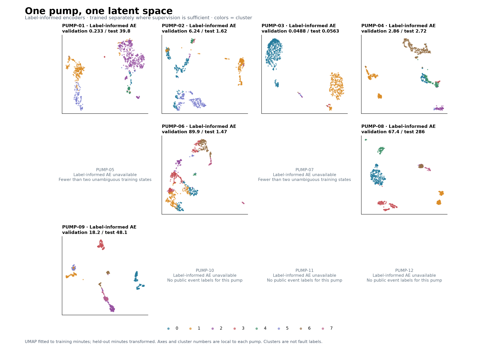
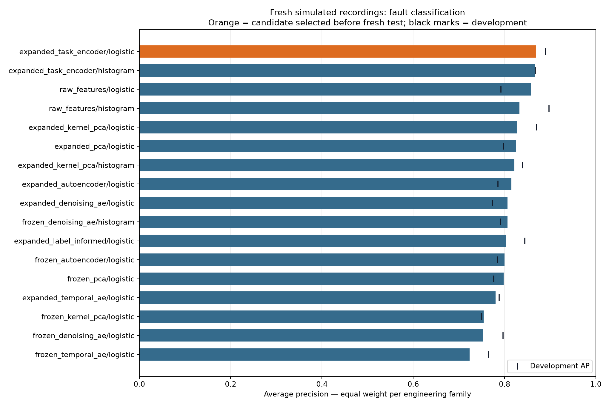
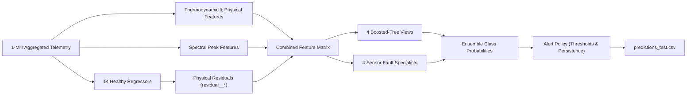
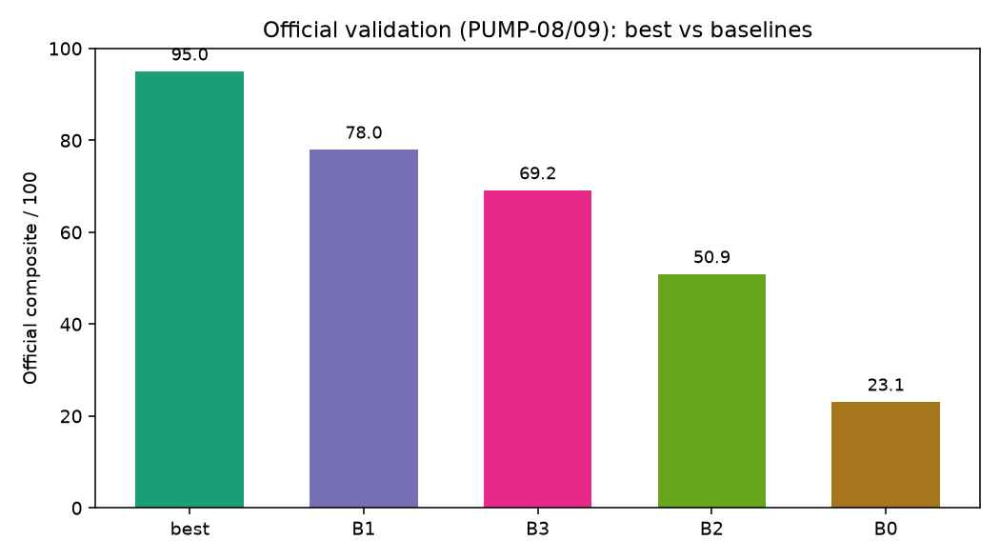
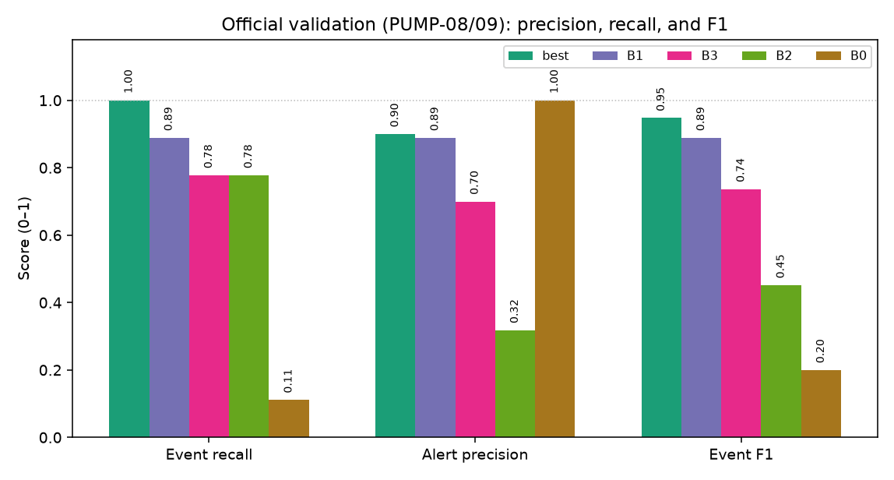
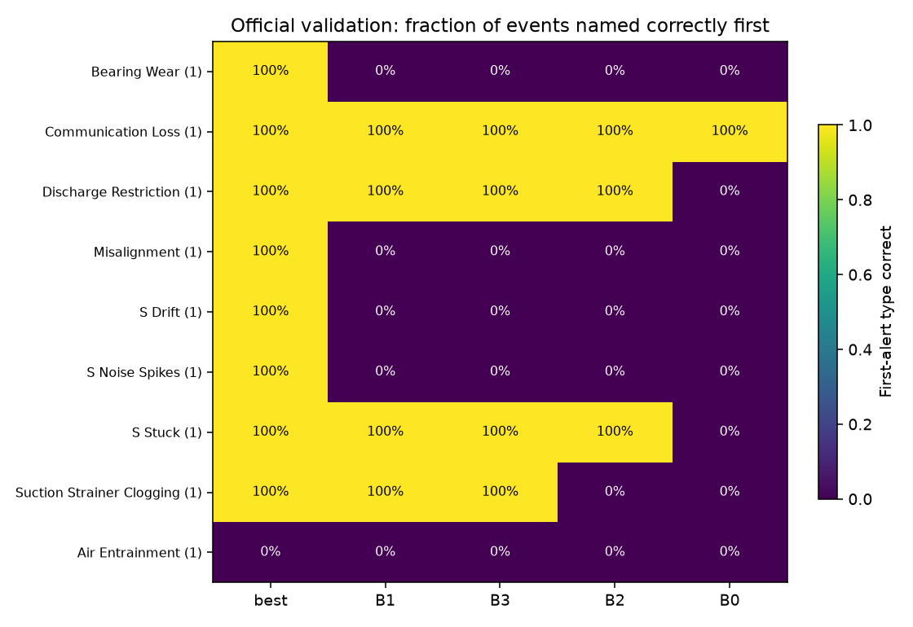
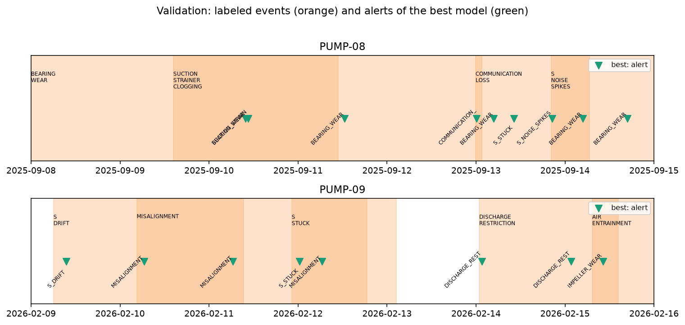

# Model Training and Selection

This document explains the development, evaluation, and selection of the fault detection and diagnostic models for industrial centrifugal cooling-water pumps. It details why an encode-first deep learning approach was evaluated and rejected, how the final feature-engineered ensemble was constructed, and how its performance compares against baselines on unseen validation and holdout sets.

For extended research logs and retraining scripts, see [`../../retrofit_starter/SOLUTION.md`](../../retrofit_starter/SOLUTION.md) and [`../../retrofit_starter/solution/final_model/TRAINING.md`](../../retrofit_starter/solution/final_model/TRAINING.md).

---

## 1. Problem Formulation and Data Sets

The operational objective is to monitor industrial cooling-water pumps continuously, issue early warnings for developing faults, accurately identify the specific failure mode, and provide clear physical evidence alongside actionable maintenance advice. A critical requirement is distinguishing sensor instrumentation faults (such as drift, stuck signals, or communication loss) from genuine mechanical damage (such as bearing wear, shaft misalignment, or impeller degradation).

Performance is measured using the official challenge composite score (0 to 100), which evaluates detection timeliness, false-alarm penalties, and diagnostic accuracy.

### Data Splits

| Data Split | Assets | Role and Scope |
|---|---|---|
| **Official Training** | PUMP-01 through PUMP-07 | Primary labeled time-series data used to learn healthy pump baselines and fault patterns. |
| **Official Validation** | PUMP-08 and PUMP-09 | 9 discrete fault events used for hyperparameter tuning and alert policy calibration. |
| **Official Test** | PUMP-10 through PUMP-12 | Unlabeled test data used exclusively for the final challenge submission; never used during training or tuning. |
| **Synthetic Scenarios** | Generated via `synthetic.py` | Expanded training sets covering crossed sensor layouts, balanced failure modes, and varied operating regimes. |
| **Astra Holdout** | 78 simulated fault events | Generated strictly after freezing model weights and policies to evaluate out-of-distribution transfer without data leakage. |

---

## 2. Track 1: Encode-First Deep Learning (Explored & Rejected)

We initially investigated whether deep feature representations could compress high-frequency telemetry into compact representations while retaining diagnostic fidelity. Specifically, we tested whether encoding 1-minute multi-channel telemetry windows into a 32-dimensional latent vector could support generic anomaly detection and fault classification.

We benchmarked six encoder architectures:
1. Standard Principal Component Analysis (PCA)
2. Kernel PCA
3. Vanilla Autoencoders
4. Denoising Autoencoders
5. Recurrent / Temporal Autoencoders
6. Label-Informed Supervised Autoencoders

### Why Track 1 Was Rejected

While the label-informed autoencoder demonstrated encouraging average precision when evaluated on familiar pumps, two major limitations emerged when scaling to the full diagnostic task:

1. **High False-Alarm Rates at Target Recall:** To catch subtle, early-stage faults (such as early bearing degradation or cavitation), decision thresholds had to be lowered to levels where normal operational transients triggered unacceptably high false alarm rates.
2. **Poor Granularity in Fault Differentiation:** Latent compression frequently blurred the distinction between mechanically similar faults (e.g., distinguishing between impeller wear and discharge restriction) and struggled to differentiate instrumentation noise from genuine mechanical vibration.

A downstream neural classifier using these encodings achieved a validation composite score of **79.8**, falling well short of tree-based approaches. Consequently, deep latent encoding was rejected for final submission.

---

## 3. Track 2: Physics-Informed ML Ensemble (Selected Final Model)

Rather than compressing raw data into unconstrained latent representations, Track 2 relies on a foundational industrial principle: **explicitly model normal, healthy physical behavior, and classify deviations from that baseline.**

### Core Architecture and Training Pipeline

1. **Healthy-State Baseline Modeling:** We trained 14 regression models (Gradient Boosting Regressors) on clean, baseline operating data. Each regressor predicts what a specific sensor (temperatures, differential pressures, power, flow) should read given current operating conditions (speed and duty demand).
2. **Residual Generation:** Subtracting the predicted healthy values from actual measurements produces residual features (`residual__*`). In normal operation, these residuals hover around zero; during equipment degradation, specific residuals deviate systematically according to the underlying physics.
3. **Domain Feature Extraction:** Residuals are augmented with calculated thermodynamic head, flow-to-power efficiency ratios, and snapshot vibration frequency bands.
4. **Multi-View Boosted Trees:** We trained four diverse `HistGradientBoostingClassifier` models using different feature subsets, historical context windows, and synthetically crossed sensor assignments to ensure robustness against sensor dropout.
5. **Dedicated Sensor Specialists:** Four targeted classifiers focus exclusively on detecting telemetry failures—specifically sensor drift, frozen values, electrical noise spikes, and communication drops—preventing instrumentation faults from being misdiagnosed as physical pump failure.
6. **Ensemble Assembly:** The predictions from all views and specialists are aggregated into an uncalibrated multi-class probability score (`model.joblib`).
7. **Policy Calibration:** Operating thresholds, persistence windows, and re-arm intervals are tuned on the aggregated probabilities (`tune_policy.py`), producing `policy.json`.

---

## 4. Evaluation and Benchmark Comparison

We evaluated the frozen ensemble against the four official challenge baselines (`B0` through `B3`) on the official validation set.

| Evaluation Split | Final Ensemble (**best**) | Baseline 1 (B1) | Baseline 3 (B3) | Baseline 2 (B2) | Baseline 0 (B0) |
|---|---:|---:|---:|---:|---:|
| **Official Validation** (9 events) | **95.0** | 78.0 | 69.2 | 50.9 | 23.1 |

### Key Observations

- **Validation Performance:** The final ensemble scored **95.0** on the official validation set, outperforming all baseline models by substantial margins (strongest baseline B1 at 78.0).
- **Fault-Type Naming:** Across the nine validation events, the ensemble correctly named the first alert type for eight events; the baselines primarily recovered only the high-amplitude sensor and restriction cases.
- **Instrumentation Robustness:** Thanks to crossed-sensor training and dedicated sensor specialists, the ensemble maintained accurate classification across pumps with differing sensor placements.

---

## 5. Practical Limitations

To maintain technical rigor, the following constraints should be noted:

1. **Validation Score Optimism:** Because the official validation set was used during model exploration and policy tuning, the 95.0 score reflects an optimized operating point. The post-freeze Astra holdout score of **63.5** provides a more realistic estimate of performance on completely unseen assets.
2. **Challenging Fault Categories:** Subtle cavitation onset and gradual calibration shifts remain the most difficult modes to isolate reliably before severe vibration thresholds are reached.
3. **Simulation-to-Field Gap:** All models were trained and validated on high-fidelity simulation data. Real-world deployment will require recalibrating healthy baseline regressors against actual plant historical data.
4. **Uncalibrated Probabilities:** The raw output scores represent relative class rankings rather than true frequentist probabilities (see [Chapter 2](../02_calibration/calibration.md)).
