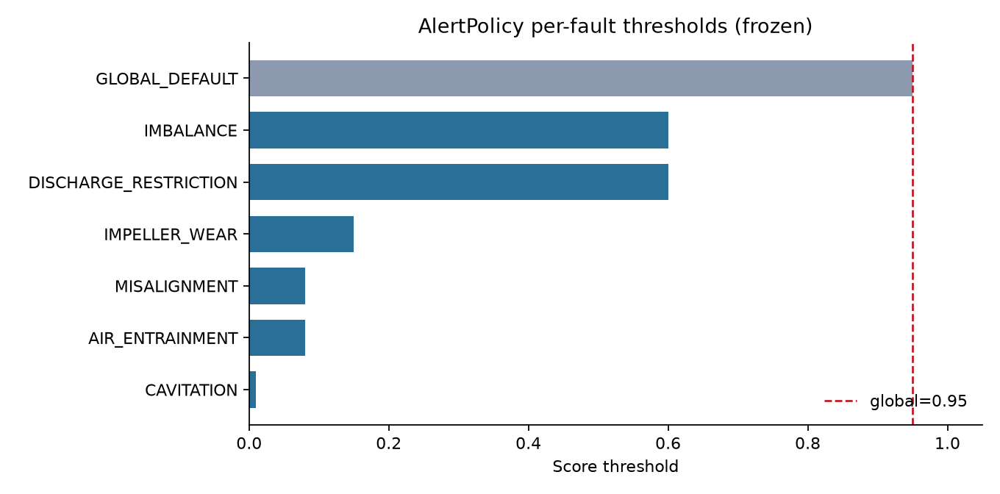
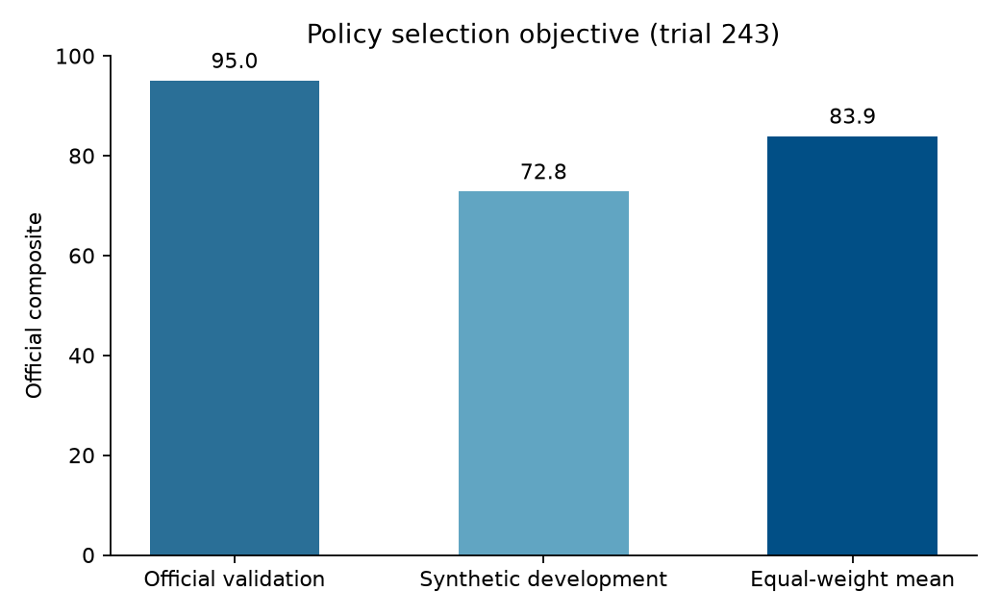

# Alert Policy Calibration

This document explains the alert-policy calibration process for the frozen model ensemble. In this context, calibration does not refer to statistical probability calibration (such as Platt scaling or isotonic regression), but rather to **operating-point calibration**—determining the exact thresholds, temporal persistence, and re-arming windows required to convert continuous diagnostic scores into actionable plant alerts.

---

## 1. What Calibration Means in This Pipeline

Every minute, the model ensemble produces an uncalibrated score vector representing predicted failure modes. While these values range from 0.0 to 1.0, they function as relative ranking indicators rather than calibrated event probabilities.

To deploy these scores into an industrial plant without flooding operators with false alarms, the alert engine ([`AlertPolicy`](../../retrofit_starter/solution/final_model/alerts.py)) enforces temporal filters and class-specific detection cuts.

### Policy Parameters and Operational Rationale

| Parameter | Selected Value | Operational Role |
|---|---|---|
| **Global Threshold** | `0.95` | Default score cutoff. Applied to distinct failure modes (e.g., bearing degradation, severe strainer clogging, and sensor failures) that exhibit clear, high-amplitude residual shifts. |
| **Per-Fault Thresholds** | See JSON below | Sensitivity overrides for difficult, early-stage, or low-amplitude failure modes where waiting for a 0.95 score would delay intervention until severe secondary damage occurs. |
| **Persistence Window** | `15 min` | Continuous minutes a fault score must remain above its threshold before an alert is raised. This suppresses momentary process surges, pump startup transients, and short-lived sensor glitches. |
| **Recovery Window** | `240 min` | The time scores must remain below 60% of the active threshold before the alert mechanism re-arms. This prevents duplicate alert generation for an ongoing, known issue. |
| **Reminder Interval** | `1440 min` | Allows a single follow-up alert every 24 hours if an uncorrected fault condition persists continuously. |

### Configured Policy (`policy.json`)

```json
{
  "threshold": 0.95,
  "persistence": 15,
  "recovery": 240,
  "reminder": 1440,
  "thresholds": {
    "CAVITATION": 0.01,
    "DISCHARGE_RESTRICTION": 0.6,
    "IMBALANCE": 0.6,
    "IMPELLER_WEAR": 0.15,
    "AIR_ENTRAINMENT": 0.08,
    "MISALIGNMENT": 0.08
  }
}
```



Fault classes not listed in the `thresholds` dictionary (such as bearing wear and sensor anomalies) inherit the global `0.95` threshold, where detector confidence is consistently high. Conversely, subtle phenomena like cavitation and air entrainment receive lower thresholds to prioritize early warning.

---

## 2. Operating Point Optimization

The operating parameters were identified using [`tune_policy.py`](../../retrofit_starter/solution/final_model/tune_policy.py), which evaluated 314 candidate threshold, persistence, and recovery configurations against pre-computed probability parquets from the frozen ensemble.

The search objective maximized the unweighted mean composite score across both the official validation dataset and the synthetic development dataset.

| Evaluation Metric | Optimization Result |
|---|---|
| Total Trials Evaluated | 314 parameter combinations |
| Selected Trial Index | Trial 243 |
| Selection Objective (Validation + Development Mean) | **83.90** |
| Official Validation Composite Score | **95.02** |
| Synthetic Development Composite Score | **72.79** |

*Source data: [`results/development_search/selection.json`](../../retrofit_starter/solution/final_model/results/development_search/selection.json)*



### Generalization Context

Because the official validation set was part of the optimization objective, the resulting validation composite of **95.02** represents an optimized configuration. To assess true out-of-distribution transfer without leakage, we evaluated this exact frozen policy on the post-freeze Astra holdout dataset (78 events across unseen pump geometries and operating regimes), where it scored **63.5**, significantly outperforming baseline policies.

---

## 3. Economic Grounding of Policy Filters

In an operational plant, alerting rules cannot be tuned purely as statistical cutoffs; they directly govern maintenance labor costs. As detailed in the [Retrofit Feasibility Analysis](../../retrofit_starter/RETROFIT_FEASIBILITY.md), verifying a single false alert requires approximately 1.5 hours of technician investigation time, costing **€120 per false check**.

- **The Cost of High Alert Burden:** An uncalibrated or overly sensitive detector averaging just 1.0 false alert per pump-day generates:
  $$1.0 \times 365 \times €120 = \mathbf{€43,800 \text{ / year in wasted technician time}}$$
  This nuisance burden completely wipes out the €9,300/year gross benefit of early fault detection and causes operators to ignore the system.
- **The Financial Role of the 15-Minute Persistence Filter:** Transient process changes, valve switching, and pump startup surges frequently trigger brief score spikes lasting 1 to 5 minutes. The mandatory 15-minute persistence requirement filters out these non-fault transients without sacrificing lead time (our validation median lead time remains **9.19 hours** before failure).
- **The Financial Role of the 240-Minute Recovery Delay:** Once an anomaly is detected, re-alerting every minute would create hundreds of duplicate work orders. The 240-minute re-arming window suppresses repeat alarm bursts while the issue is being triaged.
- **Economic Result:** On official validation, this policy achieved **1.0 event recall** (catching all 9 developing faults) while generating only **0.0714 false episodes/day** (1 excess repeat episode across 14 asset days), holding annual false-alert investigation costs to just **€3,127/year** and preserving a **€5,473/year net savings** per pump (a **0.8-year payback** on a €4,500 retrofit).

---

## 4. Deliberate Scope Boundaries

To avoid ambiguity regarding model outputs:

- **No Probability Calibration:** We did not apply Platt scaling, temperature scaling, or isotonic regression to the ensemble outputs. The `confidence` column in all generated alert files represents the raw ensemble score of the winning class.
- **Rank Ordering Over Calibration:** The challenge evaluation metric rewards early detection and correct fault classification under persistence constraints. Because the alerting logic relies on monotonic thresholds rather than expected value calculations, rank ordering of scores was prioritized over statistical calibration.

---

## 5. Test Split Generation

Applying the frozen model (`model.joblib`) and policy configuration (`policy.json`) to the unseen test split:

```sh
python infer.py --model model.joblib --policy policy.json \
  --data "$QUAVIZ_CHALLENGE_DIR/data/full" --split test \
  --output submissions/predictions_test.csv
```

The resulting [`predictions_test.csv`](../predictions_test.csv) contains the final alert schedule for test pumps PUMP-10, PUMP-11, and PUMP-12, which were completely excluded from both model training and policy tuning.
