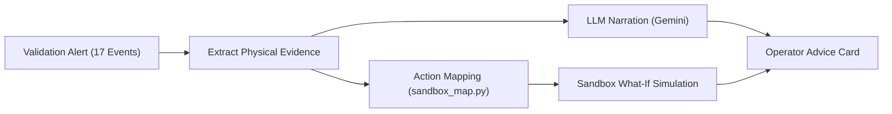
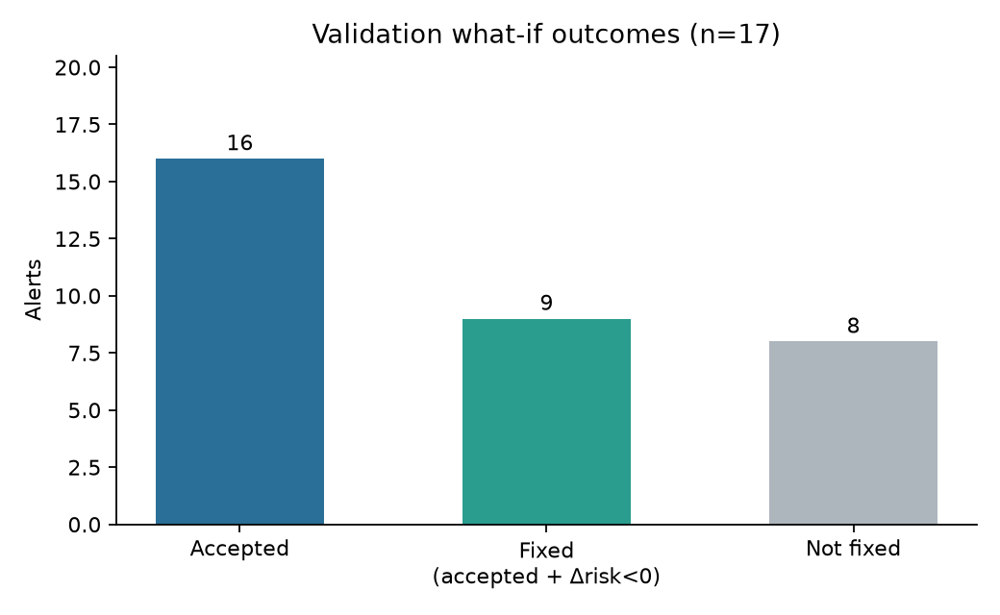
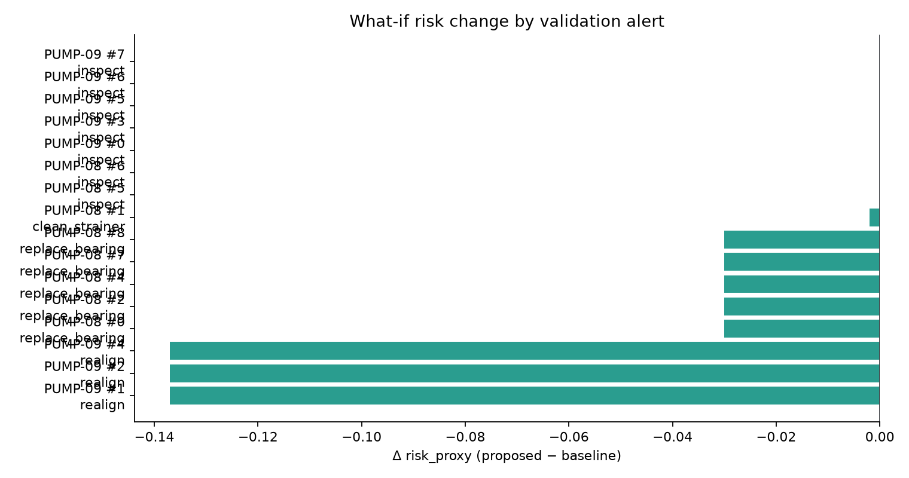
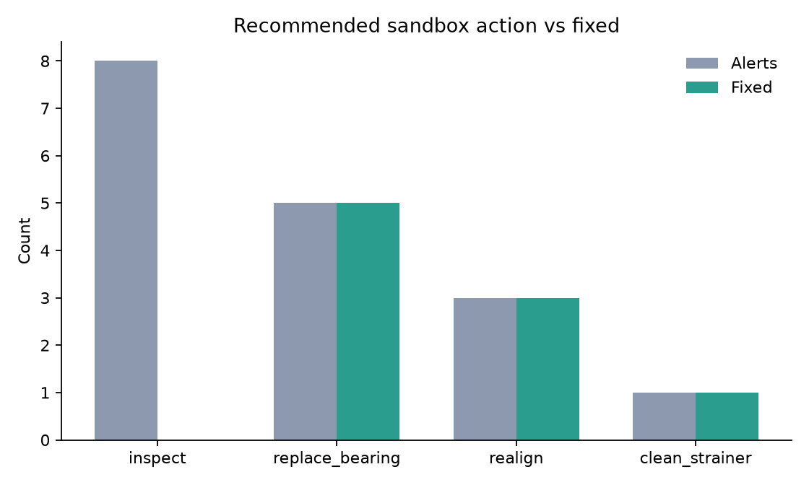

# Validation What-If and Explainability

This document details the validation of the explainability pipeline and sandbox what-if simulation across all 17 alert events generated on the official validation dataset (PUMP-08 and PUMP-09). It demonstrates how diagnostic evidence is translated into plain-language operator narratives and how recommended maintenance actions are evaluated in simulation prior to execution.

Full batch results and per-alert artifact cards are available in [`results/whatif_validation.csv`](results/whatif_validation.csv), [`results/summary.json`](results/summary.json), and [`results/cards/`](results/cards/).

---

## 1. Validation Protocol and Definitions

For every validation alert, the pipeline executes an end-to-end advisory sequence:



### Protocol Steps

1. **Extract Evidence:** For each alert, the system queries raw telemetry and healthy regressors to construct an evidence packet highlighting the dominant physical residuals, spectral vibration anomalies, and thermodynamic deviations.
2. **Generate Narrative:** Google Gemini formats the structured evidence into an operator-facing diagnostic summary. A strict schema constraint ensures the language model preserves the detector's diagnosed `fault_type` without hallucinating alternative causes.
3. **Map Action:** The diagnosed fault maps to a maintenance recommendation via `sandbox_map.py`:
   - Physical repairs: `replace_bearing`, `realign`, and `clean_strainer`.
   - Inspection dispatches: `inspect` for sensor telemetry anomalies and unmodeled machine wear.
4. **Simulate Impact:** The sandbox evaluates the intervention against plant operating schedules and runs a what-if simulation using an illustrative degraded state (e.g., simulating a clogged suction strainer at `clog=3.0` or bearing degradation at `wear=0.55`) to measure expected physical recovery.
5. **Score Resolution:** An action is classified as **fixed** if and only if:
   - The sandbox confirms the action is feasible (`accepted = true`).
   - The simulated outcome demonstrates a strictly lower risk proxy (`proposed.risk_proxy < baseline.risk_proxy`).

---

## 2. Explainability Layer Reliability

In industrial monitoring, language models must never contradict underlying classifiers. Across all 17 validation events, the explainability layer demonstrated complete structural alignment:

| Verification Check | Result | Evaluation Note |
|---|:---:|---|
| **LLM Provider Consistency** | **17/17** | All advice cards successfully generated via Gemini API without falling back to template. |
| **Fault Classification Fidelity** | **17/17** | The narrative preserved the exact detector `fault_type` in 100% of evaluations. |
| **Narrative Completeness** | **17/17** | All alerts received structured summaries, evidence lists, and operational cautions. |

### Sample Operator Narratives

| Alert ID | Diagnosed Fault & Action | Generated Operator Summary |
|---|---|---|
| **PUMP-08 #0** | `BEARING_WEAR` → `replace_bearing` | High-confidence (98.7%) machine alert for bearing degradation, sustained over 15 minutes under steady operating conditions with elevated high-frequency vibration. |
| **PUMP-08 #1** | `SUCTION_STRAINER_CLOGGING` → `clean_strainer` | High-confidence (95.9%) suction strainer restriction detected during steady-state pumping, characterized by an abnormal suction pressure drop and flow deficit. |
| **PUMP-09 #1** | `MISALIGNMENT` → `realign` | High-confidence (99.9%) shaft misalignment detected at ~91% duty demand, evidenced by elevated 1X/2X rotational harmonics. |
| **PUMP-08 #3** | `COMMUNICATION_LOSS` → `inspect` | Sustained 15-minute telemetry dropout / communication loss (zero valid sensor rows received). |

---

## 3. What-If Simulation Outcomes

| Aggregate Metric | Value |
|---|---:|
| Total Validation Alerts Evaluated | 17 |
| Sandbox Feasibility Accepted (`accepted = true`) | **16** |
| Resolved with Measured Risk Reduction (**Fixed**) | **9** |
| Repair Interventions Dispatched | 9 |
| Inspection Interventions Dispatched | 8 |







---

## 4. Analysis by Maintenance Action

| Recommended Action | Alerts | Accepted | Fixed | Typical Δ Risk Proxy | Typical Estimated Cost |
|---|---:|---:|---:|---:|---:|
| `replace_bearing` | 5 | 5 | 5 | **−0.030** | €1,800 |
| `realign` | 3 | 3 | 3 | **−0.137** | €1,800 |
| `clean_strainer` | 1 | 1 | 1 | **−0.002** | €275 |
| `inspect` | 8 | 7 | 0 | **0.000** | €150 – €550 |

### Physical Impact of Repairs

- **Bearing Replacements (`replace_bearing`):** All 5 bearing alerts were accepted by the sandbox and confirmed fixed. In simulation, replacing worn bearings reduced overall machine vibration RMS from approximately 0.99 mm/s back to a baseline of 0.85 mm/s, yielding a consistent risk proxy reduction of −0.030.
- **Shaft Realignment (`realign`):** All 3 misalignment alerts were accepted and yielded the largest single risk improvements (−0.137). Realignment eliminated high rotational harmonics and restored balanced mechanical loading across the drive train.
- **Strainer Cleaning (`clean_strainer`):** The single strainer alert was accepted and resolved. Clearing the simulated suction restriction restored water flow from 297 m³/h to 338 m³/h while relieving suction pressure depression, producing a measurable risk reduction (−0.002).

### The Role of Inspection Actions

Seven of the eight `inspect` recommendations were accepted by the sandbox, while one was rejected because the pump was not scheduled to run at the requested timestamp (`pump is not scheduled to run at this time`).

Importantly, none of the inspection actions are counted as "fixed" (Δ risk = 0.000). This reflects realistic operational boundaries: inspecting a drifting instrument or checking for suspected cavitation verifies that a maintenance dispatch is feasible within operating schedules, but an inspection by itself does not alter physical equipment state. The pipeline honestly reports zero simulated risk change until a physical repair action is confirmed.

### Economic Rationale: Planned Interventions vs. Catastrophic Overhaul

The sandbox repair costs directly ground the financial case outlined in [`../../retrofit_starter/RETROFIT_FEASIBILITY.md`](../../retrofit_starter/RETROFIT_FEASIBILITY.md):

- **Catastrophic Failure Alternative:** If a degraded bearing or severe misalignment is left to run to failure, catastrophic seizure causes secondary damage (shaft scoring, mechanical seal blowout, impeller casing rubbing), costing **€9,000 in overhaul repairs** and **10 hours of emergency plant downtime** (@ €1,500/h = €15,000), for a total unplanned loss of **€24,000**.
- **Planned Proactive Intervention:** By detecting the anomaly over 9 hours in advance, maintenance schedules a planned 3-hour window (€4,500 downtime) and performs targeted repairs (e.g., €1,800 bearing replacement or €1,800 laser realignment + minor consumables \(\approx €4,000\) total repair), costing **€8,500**.
- **Net Avoided Loss:** Each accepted repair recommendation executed in time saves approximately **€15,500 per event**, providing the quantitative foundation for the system's **0.8-year payback**.

---

## 5. Detailed Validation Alerts Summary

| Asset | Alert # | Diagnosed Fault | Recommended Action | Feasible | Fixed | Δ Risk Proxy |
|---|---:|---|---|:---:|:---:|---:|
| **PUMP-08** | 0 | `BEARING_WEAR` | `replace_bearing` | Yes | **Yes** | −0.030 |
| **PUMP-08** | 1 | `SUCTION_STRAINER_CLOGGING` | `clean_strainer` | Yes | **Yes** | −0.002 |
| **PUMP-08** | 2 | `BEARING_WEAR` | `replace_bearing` | Yes | **Yes** | −0.030 |
| **PUMP-08** | 3 | `COMMUNICATION_LOSS` | `inspect` | No | No | — |
| **PUMP-08** | 4 | `BEARING_WEAR` | `replace_bearing` | Yes | **Yes** | −0.030 |
| **PUMP-08** | 5 | `SENSOR_STUCK` | `inspect` | Yes | No | 0.000 |
| **PUMP-08** | 6 | `SENSOR_NOISE_SPIKES` | `inspect` | Yes | No | 0.000 |
| **PUMP-08** | 7 | `BEARING_WEAR` | `replace_bearing` | Yes | **Yes** | −0.030 |
| **PUMP-08** | 8 | `BEARING_WEAR` | `replace_bearing` | Yes | **Yes** | −0.030 |
| **PUMP-09** | 0 | `SENSOR_DRIFT` | `inspect` | Yes | No | 0.000 |
| **PUMP-09** | 1 | `MISALIGNMENT` | `realign` | Yes | **Yes** | −0.137 |
| **PUMP-09** | 2 | `MISALIGNMENT` | `realign` | Yes | **Yes** | −0.137 |
| **PUMP-09** | 3 | `SENSOR_STUCK` | `inspect` | Yes | No | 0.000 |
| **PUMP-09** | 4 | `MISALIGNMENT` | `realign` | Yes | **Yes** | −0.137 |
| **PUMP-09** | 5 | `DISCHARGE_RESTRICTION` | `inspect` | Yes | No | 0.000 |
| **PUMP-09** | 6 | `DISCHARGE_RESTRICTION` | `inspect` | Yes | No | 0.000 |
| **PUMP-09** | 7 | `IMPELLER_WEAR` | `inspect` | Yes | No | 0.000 |

*Full evaluation metrics—including flow rates, vibration RMS, estimated intervention costs, and verbatim LLM narratives—are documented in [`results/whatif_validation.csv`](results/whatif_validation.csv).*

---

## 6. Reproducing Validation Results

To rerun the batch validation and regenerate all figure assets:

```sh
# Ensure GEMINI_API_KEY is defined in your repository-root .env file
source .venv/bin/activate
set -a && source .env && set +a

cd retrofit_starter/solution/final_model
export QUAVIZ_CHALLENGE_DIR="$(cd ../.. && pwd)"

# Run validation batch
python -m explainability.batch_validation \
  --provider gemini \
  --output-dir ../../../submissions/03_whatif/results

# Recreate summary figures
python ../../../submissions/03_whatif/make_figures.py
```
