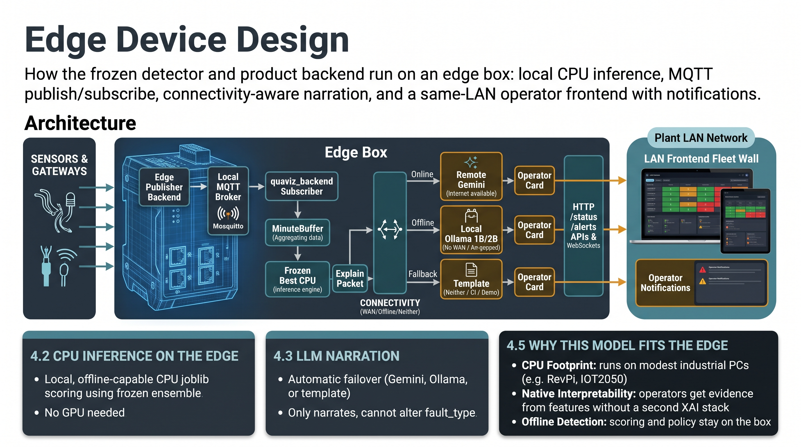

# 4. Edge device design

Software architecture for running QuaViz on an industrial edge box: local CPU inference, MQTT publish/subscribe, connectivity-aware narration, and a same-LAN operator frontend.

**This chapter is the edge software stack only.** Hardware BOM, Capex/Opex, payback math, pilot sequence, and OT zoning live in [Chapter 5](../05_retrofit_feasibility/feasibility.md) (kit source: [`../../retrofit_starter/RETROFIT_FEASIBILITY.md`](../../retrofit_starter/RETROFIT_FEASIBILITY.md)). Operator UI build notes: [`../../app/frontend/README.md`](../../app/frontend/README.md).

## 4.1 Architecture



| Role | What runs | In this repo |
|---|---|---|
| **Edge publisher** | Emits telemetry on MQTT in the kit JSON shape | `python -m retrofit_sim replay` (demo stand-in for a gateway) |
| **Local broker** | Plant/edge MQTT (no cloud required for detection) | Mosquitto via [`../../scripts/start_mqtt_demo.sh`](../../scripts/start_mqtt_demo.sh) / [`../../start.sh`](../../start.sh) |
| **Subscriber backend** | Aggregate → infer → explain → HTTP/WS API | [`../../app/backend/`](../../app/backend/) `quaviz_backend` |
| **LAN frontend** | Fleet wall, live log, detail pane, notifications | [`../../app/frontend/`](../../app/frontend/) |

Co-located on the edge box (or adjacent boxes in the same edge zone): publisher path, broker, and `quaviz_backend`. Operators on the plant LAN open the frontend against the backend HTTP API. Advice only — **no write path** to PLC, drive, valves, or safety systems.

## 4.2 CPU inference on the edge

The submitted model is the frozen ensemble in [`../../retrofit_starter/solution/final_model/`](../../retrofit_starter/solution/final_model/): healthy regressors, physics and snapshot features, four HistGradientBoosting views, four sensor specialists, then `AlertPolicy`. Inference is ordinary CPU `joblib` scoring — no GPU requirement.

`quaviz_backend` loads that same `model.joblib` + `policy.json`, buffers MQTT into official 1-min features, and runs online scoring. Detection is **local and offline-capable**, independent of cloud connectivity.

## 4.3 LLM narration by connectivity

Detection and alerting do not depend on an LLM. Narration does:

| Connectivity | Provider | Role |
|---|---|---|
| Internet available | **Gemini** (remote) | Richer operator narrative |
| No WAN / air-gapped | **Ollama** (local; 1B–2B class for later bench) | On-box narration |
| Neither / CI / demo | **Template** | Deterministic fallback |

Providers live in [`explainability/llm/`](../../retrofit_starter/solution/final_model/explainability/llm/) and are selected via `--provider` / `LLM_PROVIDER`. Automatic connectivity-aware failover is design intent; switch manually today.

The LLM **cannot** change `fault_type`; it only narrates the explain packet. Sandbox what-if remains measurement-only.

## 4.4 Same-LAN frontend and notifications

While the fleet is running, operators on the **same network** as the backend use the frontend to:

1. See a **fleet wall** of pumps (green / amber / red) with live context (sea temp, duty, schedule).
2. Watch a **live event log** and open pump detail (alerts, evidence, narrative, what-if).
3. Receive **notifications** when new alerts or explanations arrive.

The UI stays usable when WAN/Gemini is down: cards can still come from Ollama or template. Notifications are advisory — they never command plant equipment.

## 4.5 Why this model fits the edge (vs deep learning)

We rejected the encode-first deep track for submission (Chapter 1). For edge deployment that choice also matters:

- **CPU footprint:** boosted trees + residuals run on modest industrial PCs without a GPU.
- **Native interpretability:** the explain packet is built from top residuals / physics / snapshots versus healthy expectation — no second XAI stack required for operator evidence.
- **Offline detection:** scoring and policy stay on the box; only narrative quality tracks connectivity.

## 4.6 Demo mapping

```sh
./start.sh
# broker + publishers + quaviz_backend + fleet console (opens http://127.0.0.1:5173)
```

Hardware packaging, Capex/Opex, class/cyber constraints, and pilot sequence are **not** repeated here — see [Chapter 5](../05_retrofit_feasibility/feasibility.md).
