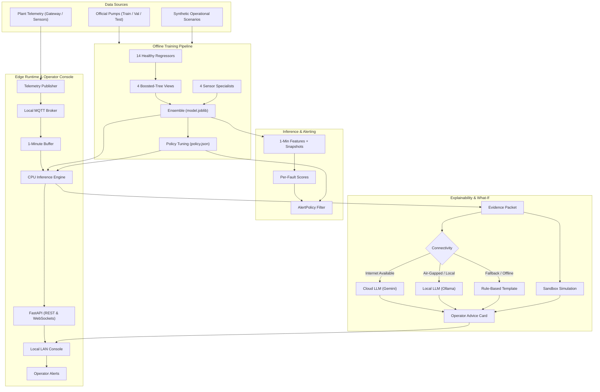

# System Architecture

This document describes the end-to-end architecture of the pump diagnostic and advisory system, tracing telemetry from raw sensor collection through model scoring, operator explanation, and edge deployment on a local industrial network.

## Architectural Principles

The system follows a strict separation of responsibilities:

1. **The model decides:** A frozen machine learning ensemble classifies the fault type and calculates confidence based on sensor data.
2. **Features explain:** Diagnostic evidence is derived directly from physical residuals, spectral features, and thermodynamics relative to a healthy baseline.
3. **The language model narrates:** An LLM formats the structured evidence into concise operator-facing explanations. The LLM cannot alter the diagnosed fault type or modify alert status.
4. **The sandbox measures:** Recommended interventions are simulated in a physical model to estimate expected changes in risk, flow, and vibration before taking equipment offline.
5. **Humans approve:** The system operates purely as an advisory tool. It does not send write commands to PLCs, drives, or safety instrumentation.

---

## End-to-End Pipeline

---

## Component Responsibilities

### 1. Model Ensemble (`model.joblib`)
- **Role:** Evaluates 1-minute aggregated feature vectors and computes uncalibrated class probability scores for all machine and sensor fault categories.
- **Implementation:** An ensemble combining 14 healthy-baseline regressors (generating physical deviation residuals), four diverse `HistGradientBoostingClassifier` views, and four specialized sensor fault detectors.
- **Constraints:** Optimized for CPU-only execution on industrial edge computers without requiring GPU acceleration.

### 2. Alert Policy (`policy.json`)
- **Role:** Converts continuous minute-by-minute classification scores into discrete, actionable plant alerts.
- **Mechanism:** Enforces class-specific score thresholds, a mandatory 15-minute persistence requirement to suppress transient spikes, a 240-minute re-arming recovery delay, and a 24-hour reminder interval for unresolved anomalies.

### 3. Explainability Packet
- **Role:** Assembles objective diagnostic data supporting the alert.
- **Contents:** Identifies the top contributing physical residuals (e.g., unexpected pressure drops or elevated motor power), spectral vibration peaks, and baseline comparisons. This structured packet forms the ground truth for downstream explanation.

### 4. Language Model Narration
- **Role:** Translates the quantitative explainability packet into clear, natural language summaries for operators and maintenance technicians.
- **Connectivity-Aware Routing:**
  - **Cloud:** Uses remote Gemini models when internet connectivity is active for richer narrative context.
  - **Local:** Runs lightweight quantized models (such as Ollama) when deployed in air-gapped industrial environments.
  - **Fallback:** Defaults to deterministic string templates if LLM services are unavailable.
- **Safety Boundary:** The LLM is strictly constrained to narrative generation; it cannot modify the detector's classification, thresholding, or risk scoring.

### 5. Sandbox What-If Validation
- **Role:** Tests recommended actions (such as strainer cleaning, bearing replacement, or shaft realignment) in a physical simulation before dispatching maintenance teams.
- **Output:** Validates maintenance window feasibility, verifies operational constraints, and calculates expected improvements in risk index, flow rate, and vibration levels.

### 6. Edge Runtime & Local Console (`quaviz_backend` & `app/frontend`)
- **Role:** Ingests plant telemetry via local MQTT, aggregates data into rolling 1-minute windows, runs real-time inference, and serves a live dashboard to operator workstations on the local network.
- **Safety Boundary:** Provides read-only monitoring and operator notifications. It maintains no network routes or control protocols back to operational plant controllers.

---

## Further Reading

- Model development and training details: [`../01_training/training.md`](../01_training/training.md)
- Alert threshold calibration and tuning: [`../02_calibration/calibration.md`](../02_calibration/calibration.md)
- What-if validation and action outcomes: [`../03_whatif/whatif_validation.md`](../03_whatif/whatif_validation.md)
- Edge software stack (MQTT, CPU infer, LLM, LAN UI): [`../04_edge/edge_design.md`](../04_edge/edge_design.md)
- Retrofit feasibility / Capex / Opex / payback: [`../05_retrofit_feasibility/feasibility.md`](../05_retrofit_feasibility/feasibility.md)
